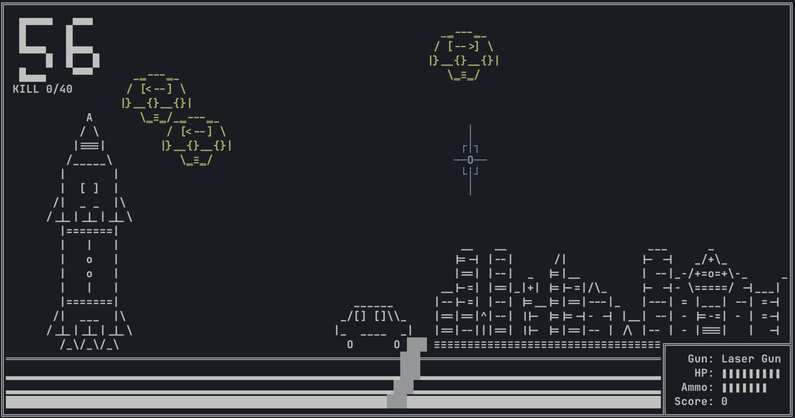
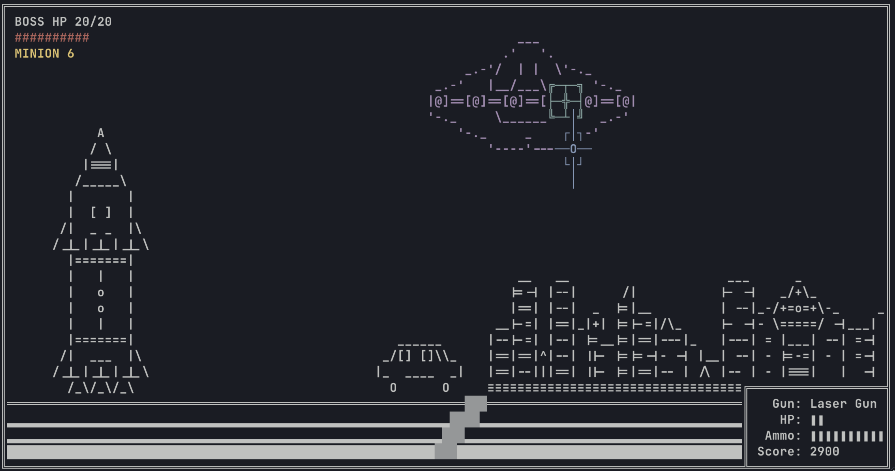

**基本ルール**
| 項目        | 説明                                      |
| --------- | --------------------------------------- |
| プレイヤー移動   | 移動不可、方向キーで照準（カーソル）のみ操作可能                |
| 攻撃方法（通常弾）  | 命中した場合は弾薬を消費せず、弾薬を+1回復。外れた場合は1発消費 |
| 攻撃方法（弾道兵器） | 命中してもしなくても1発消費。命中した場合のみHPを+1回復（上限9） |
| プレイヤー初期HP | 値：9                                  |
| プレイヤー初期弾薬 | 値：7発                               |

**準備フェーズ（60秒）**
| 項目      | 数値 / 説明                      |
| ------- | ---------------------------- |
| 敵機の総数   | 40機                          |
| 出現間隔    | 1.5秒ごとに出現                    |
| 生存時間    | 各敵機は3〜7秒生存後にプレイヤーへ攻撃（-1HP）   |
| 撃墜メカニズム | 通常弾で撃墜すると弾薬は消費されず、さらに+1補給される |
| 弾道兵器の効果 | 撃墜時にHPを+1回復（弾薬は1発消費）      |
| ボーナス条件  | **全機撃墜（40機）でBoss戦に僕従が出現しない** |

**Bossフェーズ（Boss撃破まで継続）**

| 項目         | 数値 / 説明                                      |
| ---------- | -------------------------------------------- |
| Boss HP    | 20                                           |
| Boss 弱点の出現 | 4秒ごとに切り替わり、2秒間表示される                          |
| Boss 攻撃間隔  | 7秒ごとに攻撃（-3HP）、**弱点に命中するとこのクールタイムが即時リセットされる** |
| 僕従の召喚      | 準備フェーズで40機未満撃墜の場合、Bossは6秒ごとに僕従を1〜2体召喚        |
| 僕従のメカニズム   | 僕従は8秒後に-2HPのダメージを与え、その後消滅                    |
| 命中時の効果     | 弱点・僕従に命中すると：通常弾は弾薬+1、弾道兵器はHP+1             |
| 攻撃制限（ボーナス） | 全機撃墜達成時、**Bossの攻撃は本体攻撃と弱点切替のみになり、テンポが速くなる**  |

**撃墜数と僕従の出現数対応表**

| 撃墜数 | 僕従数 |
| --- | --- |
| 0   | 20  |
| 8   | 16  |
| 20  | 10  |
| 32  | 4   |
| 40  | 0   |

**ビルド方法**

画面は120×30文字以上の端末で、UTF-8で表示してください。

| 環境 | 方法 |
| --- | --- |
| Windows（Visual Studio） | `main.cpp` をプロジェクトに追加し、C/C++ の追加オプションに `/utf-8` を指定する |
| Windows / macOS / Linux（CMake） | `cmake -B build` → `cmake --build build` |
| macOS / Linux（直接） | `clang++ -std=c++17 -O2 main.cpp -o CmdGame` → `./CmdGame` |
